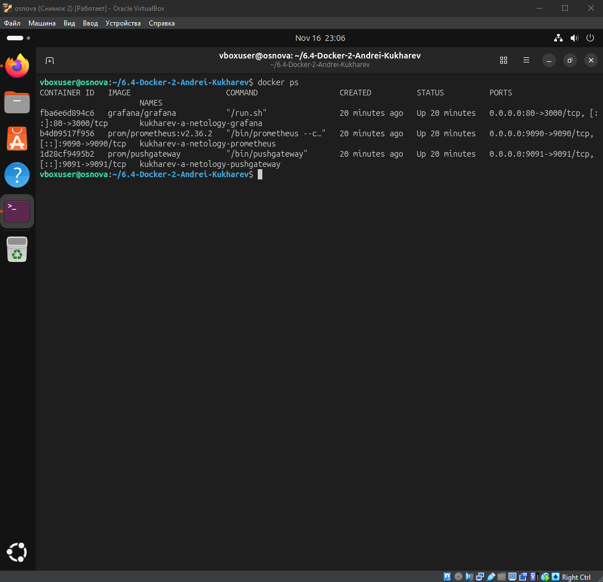
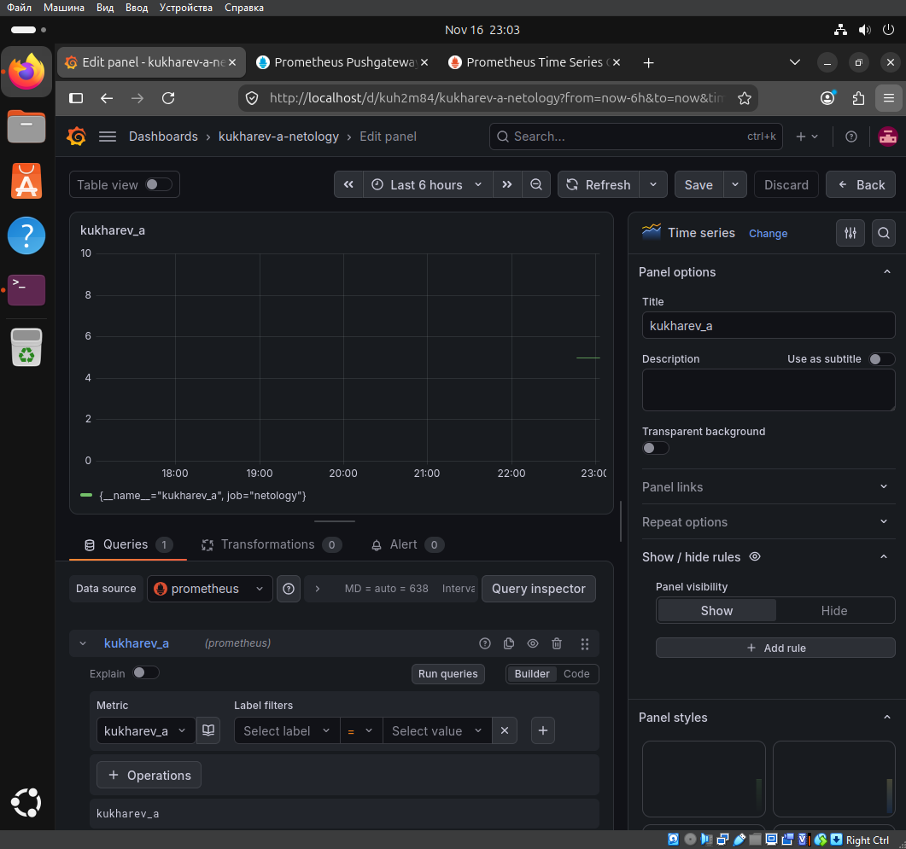
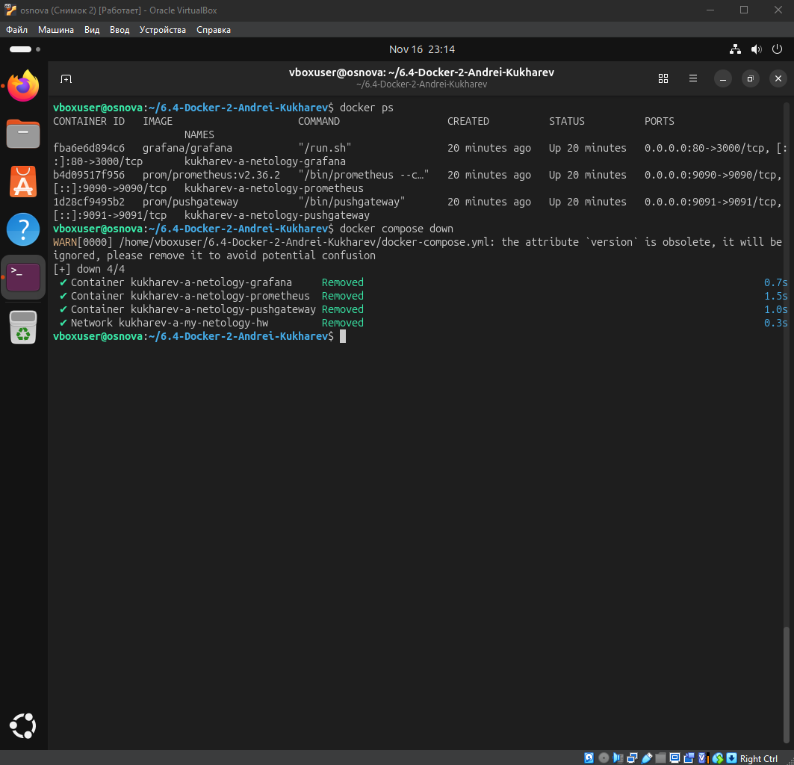

# 6.4. Docker. Часть 2 — Андрей Кухарев

## Задание 1. Docker Compose — зачем он нужен

Docker Compose — это инструмент, который описывает весь сервис в одном
файле: какие контейнеры запускать, какие у них порты, тома и сети.
Вместо десятка команд docker run достаточно одной — docker compose up -d.
Удобно тем, что конфигурация лежит в git целиком, её видно и можно
повторить на другой машине, не вспоминая, что я вводил в прошлый раз.

## Задание 2. Первичные настройки
Текст конфига: 

```yaml
version: '3'

services:

volumes:

networks:
  kukharev-a-my-netology-hw:
    driver: bridge
    ipam:
      config:
        - subnet: 10.5.0.0/16
```
## Задание 3. Prometheus

Добавлен сервис Prometheus, контейнер `kukharev-a-netology-prometheus`,
порт 9090, конфигурация из папки `prometheus/`, данные в томе `prometheus_data`.

```yaml
version: '3'

services:
  prometheus:
    image: prom/prometheus:v2.36.2
    container_name: kukharev-a-netology-prometheus
    ports:
      - "9090:9090"
    volumes:
      - ./prometheus/:/etc/prometheus/
      - prometheus_data:/prometheus
    networks:
      - kukharev-a-my-netology-hw

volumes:
  prometheus_data: {}

networks:
  kukharev-a-my-netology-hw:
    driver: bridge
    ipam:
      config:
        - subnet: 10.5.0.0/16
```
## Задание 4. Pushgateway

Добавлен сервис Pushgateway, контейнер `kukharev-a-netology-pushgateway`,
порт 9091 открыт наружу. Сервис назван `pushgateway`, потому что на это имя
ссылается `prometheus.yml` в блоке `scrape_configs`.

```yaml
version: '3'

services:
  prometheus:
    image: prom/prometheus:v2.36.2
    container_name: kukharev-a-netology-prometheus
    ports:
      - "9090:9090"
    volumes:
      - ./prometheus/:/etc/prometheus/
      - prometheus_data:/prometheus
    networks:
      - kukharev-a-my-netology-hw

  pushgateway:
    image: prom/pushgateway
    container_name: kukharev-a-netology-pushgateway
    ports:
      - "9091:9091"
    networks:
      - kukharev-a-my-netology-hw

volumes:
  prometheus_data: {}

networks:
  kukharev-a-my-netology-hw:
    driver: bridge
    ipam:
      config:
        - subnet: 10.5.0.0/16
```

## Задание 5. Grafana

Добавлен сервис Grafana, контейнер `kukharev-a-netology-grafana`. Внешний доступ
через порт 80 докер-сервера, внутри контейнера Grafana видит 3000.
Кастомные настройки лежат в `grafana/custom.ini` и подключены томом, путь к файлу
передан переменной окружения `GF_PATHS_CONFIG`. Данные Grafana — в томе `grafana_data`.
В `custom.ini` задан логин `kukharev-a` и пароль `netology`.

```ini
[security]

admin_user = kukharev-a
admin_password = netology
```

```yaml
version: '3'

services:
  prometheus:
    image: prom/prometheus:v2.36.2
    container_name: kukharev-a-netology-prometheus
    ports:
      - "9090:9090"
    volumes:
      - ./prometheus/:/etc/prometheus/
      - prometheus_data:/prometheus
    networks:
      - kukharev-a-my-netology-hw

  pushgateway:
    image: prom/pushgateway
    container_name: kukharev-a-netology-pushgateway
    ports:
      - "9091:9091"
    networks:
      - kukharev-a-my-netology-hw

  grafana:
    image: grafana/grafana
    container_name: kukharev-a-netology-grafana
    user: "472"
    ports:
      - "80:3000"
    volumes:
      - ./grafana/custom.ini:/etc/grafana/custom.ini
      - grafana_data:/var/lib/grafana
    environment:
      - GF_PATHS_CONFIG=/etc/grafana/custom.ini
    networks:
      - kukharev-a-my-netology-hw

volumes:
  prometheus_data: {}
  grafana_data: {}

networks:
  kukharev-a-my-netology-hw:
    driver: bridge
    ipam:
      config:
        - subnet: 10.5.0.0/16
```

Проверка: `docker ps` — три контейнера; страница Grafana открывается
на `http://localhost` (порт 80), вход `kukharev-a` / `netology`.

## Задание 6. Порядок запуска, перезапуски, сеть

Настроена очерёдность: сначала `pushgateway`, затем `prometheus` (зависит от
pushgateway), последней `grafana` (зависит от prometheus) — через `depends_on`.
Для всех сервисов включён режим перезапуска `restart: always` — Docker поднимает
контейнер после падения или перезагрузки ВМ. Все три контейнера работают
в одной сети `kukharev-a-my-netology-hw`, поэтому обращаются друг к другу
по именам сервисов. Запуск выполняется в detached-режиме: `docker compose up -d`.

```yaml
version: '3'

services:
  prometheus:
    image: prom/prometheus:v2.36.2
    container_name: kukharev-a-netology-prometheus
    ports:
      - "9090:9090"
    volumes:
      - ./prometheus/:/etc/prometheus/
      - prometheus_data:/prometheus
    depends_on:
      - pushgateway
    restart: always
    networks:
      - kukharev-a-my-netology-hw

  pushgateway:
    image: prom/pushgateway
    container_name: kukharev-a-netology-pushgateway
    ports:
      - "9091:9091"
    restart: always
    networks:
      - kukharev-a-my-netology-hw

  grafana:
    image: grafana/grafana
    container_name: kukharev-a-netology-grafana
    user: "472"
    ports:
      - "80:3000"
    volumes:
      - ./grafana/custom.ini:/etc/grafana/custom.ini
      - grafana_data:/var/lib/grafana
    environment:
      - GF_PATHS_CONFIG=/etc/grafana/custom.ini
    depends_on:
      - prometheus
    restart: always
    networks:
      - kukharev-a-my-netology-hw

volumes:
  prometheus_data: {}
  grafana_data: {}

networks:
  kukharev-a-my-netology-hw:
    driver: bridge
    ipam:
      config:
        - subnet: 10.5.0.0/16
```

## Задание 7. Метрика, источник данных и график

Метрика отправлена в Pushgateway:
`echo "kukharev_a 5" | curl --data-binary @- http://localhost:9091/metrics/job/netology`

В Grafana добавлен источник данных Prometheus с URL `http://prometheus:9090`
(обращение по имени сервиса внутри общей сети). По этой метрике построен график
и сохранён дашборд `kukharev-a-netology`.





```yaml
version: '3'

services:
  prometheus:
    image: prom/prometheus:v2.36.2
    container_name: kukharev-a-netology-prometheus
    ports:
      - "9090:9090"
    volumes:
      - ./prometheus/:/etc/prometheus/
      - prometheus_data:/prometheus
    depends_on:
      - pushgateway
    restart: always
    networks:
      - kukharev-a-my-netology-hw

  pushgateway:
    image: prom/pushgateway
    container_name: kukharev-a-netology-pushgateway
    ports:
      - "9091:9091"
    restart: always
    networks:
      - kukharev-a-my-netology-hw

  grafana:
    image: grafana/grafana
    container_name: kukharev-a-netology-grafana
    user: "472"
    ports:
      - "80:3000"
    volumes:
      - ./grafana/custom.ini:/etc/grafana/custom.ini
      - grafana_data:/var/lib/grafana
    environment:
      - GF_PATHS_CONFIG=/etc/grafana/custom.ini
    depends_on:
      - prometheus
    restart: always
    networks:
      - kukharev-a-my-netology-hw

volumes:
  prometheus_data: {}
  grafana_data: {}

networks:
  kukharev-a-my-netology-hw:
    name: kukharev-a-my-netology-hw
    driver: bridge
    ipam:
      config:
        - subnet: 10.5.0.0/16
```
## Задание 8. Остановка и удаление контейнеров

Все контейнеры остановлены и удалены одной командой:

```bash
docker compose down
```

Команда удалила три контейнера и сеть `kukharev-a-my-netology-hw`.
Тома `prometheus_data` и `grafana_data` при этом сохранились — данные не потеряны.

